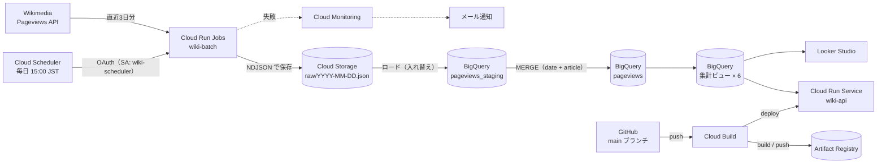
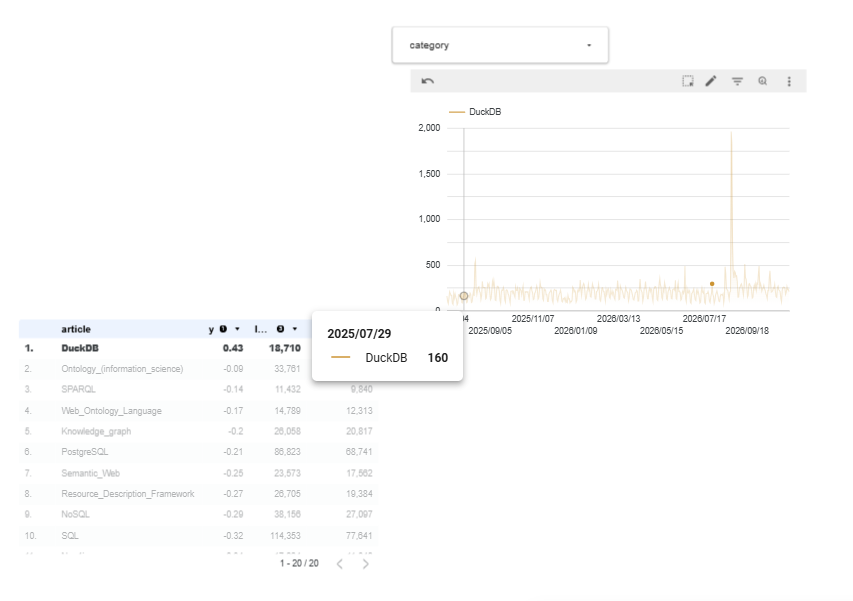

# Wikipedia 閲覧数で見る「データベース技術のトレンド」日次分析基盤（Google Cloud）

英語版 Wikipedia の、データベース関連の20記事について、日次の閲覧数を毎日自動で取得します。取得したデータは BigQuery に蓄積し、API と Looker Studio のダッシュボードで公開しています。

| 提出物 | 場所 |
|---|---|
| API（公開 URL） | https://wiki-api-32614732480.asia-northeast1.run.app |
| ダッシュボード（Looker Studio） | https://datastudio.google.com/reporting/1c79a85b-ef05-4646-a100-97e64569f82b |
| クラウドの基礎まとめ | [docs/gcp_basics.md](docs/gcp_basics.md) |
| フェーズごとの学び・詰まり・解決の記録 | [docs/catchup_log.md](docs/catchup_log.md) |
| 課題の説明文 | [docs/assignments.md](docs/assignments.md) |

---

## 1. 構成図



### 処理の流れ
1. **取得**：Cloud Scheduler が毎日 15:00（日本時間）に、Cloud Run Jobs の `wiki-batch` を起動する。Job は、`app/config/articles.yaml` に書いた20記事について、Wikimedia Pageviews API（`en.wikipedia` / `all-access` / `user` / `daily`）から**直近3日分**を取得する
2. **保存**：日付ごとに NDJSON にして、GCS の `gs://pantarhei-wiki-trend-20261116-raw/raw/YYYY-MM-DD.json` に保存する
3. **蓄積**：今回保存したファイルを、BigQuery のステージングテーブルに入れ替えでロード（`WRITE_TRUNCATE`）する。そのあと、`date` + `article` をキーにして、本体テーブル `pageviews` に `MERGE` する
4. **集計**：6つのビュー（7日移動平均・前週比・月次合計・カテゴリのシェア・前年同期比ランキング・急上昇日）
5. **公開**：FastAPI（Cloud Run Service）と、Looker Studio のダッシュボード
6. **監視**：Job が失敗すると、Cloud Monitoring からメールが届く
7. **CI/CD**：main ブランチに push すると、Cloud Build が API を build → push → deploy する

### ディレクトリ構成
```
.
├── api/                 # FastAPI（Cloud Run Service）
│   ├── main.py
│   ├── requirements.txt
│   └── Dockerfile
├── app/
│   ├── batch/           # 取得バッチ（Cloud Run Jobs）
│   │   ├── main.py
│   │   ├── requirements.txt
│   │   └── Dockerfile
│   ├── config/
│   │   └── articles.yaml   # 対象の20記事とカテゴリ（コードに直書きしない）
│   └── sql/             # テーブル定義・MERGE・集計ビュー
├── cloudbuild.yaml      # Cloud Build の設定（API の自動デプロイ）
└── docs/                # 基礎まとめ・学びの記録・トレンドの所見・画像
```

---

## 2. 各サービスを選んだ理由

| 用途 | サービス | 理由 |
|---|---|---|
| データ取得 | Cloud Run Jobs | 1日1回、数十秒で終わる処理なので、HTTP で待ち受け続ける Service より、**動いて終わる Jobs** が合っている。動いている時間だけ課金される |
| 生データの保存 | Cloud Storage | API から取ったそのままのデータ（NDJSON）を、日付ごとのファイルで残しておける。BigQuery 側でやり直しが必要になっても、**API を叩き直さずに** GCS からロードし直せる |
| 蓄積・集計 | BigQuery | サーバーを用意せずに SQL で集計でき、読んだデータ量だけ課金される。データが小さいうちは、ほぼ無料 |
| 定期実行 | Cloud Scheduler | SA（OAuth）で認証して Job を起動するので、Job を外部に公開しなくてよい |
| 公開 | Cloud Run Service + Looker Studio | API はプログラムから使う人向け、ダッシュボードは目で見る人向けと、使う人に合わせて2つ用意した |
| CI/CD | Cloud Build | GitHub と連携でき、main に push するだけで build → push → deploy が自動で動く。手で打っていたときのタグの付け間違いや、push 忘れによる `Image not found` がなくなる |

リージョンは、すべて **`asia-northeast1`（東京）** に揃えました。BigQuery は、ロケーションの違う GCS からはロードできないためです。リージョン間の転送料金もかかりません。

---

## 3. データの設計と、壊れにくくするための工夫

### テーブル
`wiki_trend.pageviews`（`date DATE, article STRING, category STRING, views INT64`）
- `date` で日単位にパーティション分割。期間で絞ると、その日付の分だけを読む
- `category, article` でクラスタリング

### 冪等性（何回実行しても結果が同じ）
- `bq load` は既定で「追加」なので、同じファイルを2回ロードすると重複した（1日 20行 → 40行）
- そこで、**ステージングテーブルに入れ替えでロード → `date` + `article` をキーに `MERGE`** にした。同じ日・同じ記事の行は UPDATE、新しい行だけ INSERT されるので、何回実行しても1日20行のまま

### Wikimedia の公開の遅れへの対応
- 前日分は日付が変わってすぐには公開されず、記事によって公開のタイミングも違った（Scheduler からの初回の実行は `404` で失敗した）
- daily でも**直近3日分**を取るようにした。取りこぼした日は翌日の実行で埋まり、MERGE があるので取り直しても重複しない

### 失敗に気づく仕組み
- Cloud Monitoring のアラートポリシー：指標 `run.googleapis.com/job/completed_execution_count` が `result = failed` で 0 より大きいとき、メールで通知する
- `gcloud run jobs execute --update-env-vars=MODE=broken` で、その回だけわざと失敗させて確かめた。失敗から約5〜8分でメールが1通届いた（リトライの4回分は、1つのインシデントにまとめられた）
- 原因は、Cloud Logging のアプリのログ（Python のトレースバック）で追える

### 自動実行の実績
（3日分以上の実行履歴・ログ・BigQuery の日付ごとの件数を記入）

---

## 4. API

| エンドポイント | 返すもの |
|---|---|
| `GET /health` | 動作確認（`{"status":"healthy","env":"prod"}`） |
| `GET /articles` | 対象の20記事とカテゴリ |
| `GET /trend?article=Knowledge_graph&days=30` | 指定した記事の、直近 N 日の閲覧数と7日移動平均 |
| `GET /ranking?category=グラフデータ&days=90` | 指定したカテゴリの中での伸び率ランキング（直近 N 日の合計 ÷ その前の N 日の合計 − 1） |

- 利用者が入力する値（`article` / `category` / `days`）は、すべて**パラメータ化クエリ**で BigQuery に渡す。`article=' OR 1=1 --` を送っても、SQL として解釈されず、404 になることを確かめた
- `days` は 1〜90 に制限した（範囲外は FastAPI が自動で `422` を返す）
- 該当するデータがない記事・カテゴリは `404`
- BigQuery へは、鍵ファイルではなく、Cloud Run に紐付けた SA `wiki-api` で認証する

---

## 5. IAM（サービスアカウントと権限）

用途ごとに SA を4つに分け、それぞれに必要な権限だけを、できるだけ狭い範囲に付けました。**SA の鍵（JSON）は1つも作っていません**。ローカルでは ADC、Cloud Run では紐付けた SA の認証情報が、自動で使われます。

| SA | 使う場所 | ロール | 付けた範囲 | 必要な理由 |
|---|---|---|---|---|
| `wiki-batch` | Cloud Run Jobs | `roles/storage.objectUser` | バケット `pantarhei-wiki-trend-20261116-raw` | 生データの保存（同じ日付のファイルを上書きするので、作成だけの `objectCreator` では足りない） |
| | | `roles/bigquery.dataEditor` | データセット `wiki_trend` | ステージングへのロードと、本体への MERGE |
| | | `roles/bigquery.jobUser` | プロジェクト | ロードやクエリの「ジョブ」を実行する（ジョブはプロジェクト単位のもの） |
| `wiki-scheduler` | Cloud Scheduler | `roles/run.invoker` | Job `wiki-batch` | Job を起動する**だけ**。GCS や BigQuery には触れない |
| `wiki-api` | Cloud Run Service | `roles/bigquery.dataViewer` | データセット `wiki_trend` | データを**読むだけ**（batch と違い、書き込みはできない） |
| | | `roles/bigquery.jobUser` | プロジェクト | クエリを実行する |
| `wiki-cloudbuild` | Cloud Build | `roles/artifactregistry.writer` | リポジトリ `wiki-trend` | イメージの push |
| | | `roles/run.developer` | プロジェクト | Cloud Run へのデプロイ。IAM を変更できる `run.admin` より小さい権限 |
| | | `roles/iam.serviceAccountUser` | SA `wiki-api` | 「`wiki-api` の SA で動くサービス」をデプロイするため（`actAs`） |
| | | `roles/logging.logWriter` | プロジェクト | ビルドのログを書く |

- API の公開（`allUsers` に `roles/run.invoker`）は、データが Wikipedia の公開データなので許可した。公開設定は最初のデプロイで付け、Cloud Build からは変更しない（そのため、Cloud Build に `run.admin` は不要）
- 起動役（`wiki-scheduler`）と実行役（`wiki-batch`）、読む役（`wiki-api`）と書く役（`wiki-batch`）を分けたので、どれか1つの SA が乗っ取られても、被害はその役割の範囲に収まる

---

## 6. 月額コストの概算

データが小さく（BigQuery の本体テーブルは約 600 KB）、処理も1日1回なので、**ほぼすべてが無料枠に収まる見込み**です。

| サービス | 使い方 | 月額の見込み |
|---|---|---|
| Cloud Run Jobs | 1日1回、数十秒（1 vCPU / 512 MiB） | 無料枠内（0円） |
| Cloud Run Service | アクセスが少なく、リクエストがないときは0台 | 無料枠内（0円） |
| BigQuery | ストレージ 1 MB 未満、クエリは月 1 TB の無料枠に対してごくわずか | 無料枠内（0円） |
| Cloud Storage | 約500ファイル、合計 1 MB 未満 | ほぼ0円 |
| Cloud Scheduler | 1ジョブ（3ジョブまで無料） | 0円 |
| Artifact Registry | イメージ（push のたびに増える） | 無料枠（0.5 GB）を超えた分が 1 GB あたり月 約 0.1 ドル。数十円程度 |
| Cloud Build | push のたびに1分前後 | 無料枠内の見込み |
| Cloud Monitoring / Logging | アラート1つ、ログは少量 | 無料枠内（0円） |
| **合計** | | **月 0円〜数十円程度** |

予算アラート（月 1,000 円、50% / 90% / 100% で通知）を設定しています。ただし、予算アラートは通知するだけで、使用は止まりません。

### コストを抑えるための工夫
- **パーティション**：期間で絞るクエリは、その期間の分だけを読む。dry run で、全期間の `SELECT *` は 621,476 bytes、11月分だけなら 21,046 bytes（約 1/30）になることを確かめた
- **API の `days` の上限**：公開 API は誰でも呼べるので、`days` を最大90日に制限し、1回に返すデータの量を抑えた。ただし、今の SQL は読み込みの段階では全期間を読んでいる（`/trend` は移動平均を正しく計算するため、`/ranking` は `WHERE` で期間を絞っていないため）。データが増えたら、`/ranking` に `WHERE date >= ...` を足してパーティションで絞るのが次の改善点
- **Jobs と、0台まで減る Service**：常に動き続けるサーバーを持たない
- **同じリージョンに揃える**：リージョン間の転送料金がかからない
- **今後の改善**：Artifact Registry にクリーンアップポリシーを設定し、古いイメージを自動で消す

---

## 7. ダッシュボードから読み取れるトレンド

詳しくは [docs/findings.md](docs/findings.md) にまとめています。

1. **20記事の中で、伸びているのは DuckDB だけ**：直近3か月の閲覧数は、1年前の同じ時期より **+43%**（18,710 → 26,688）。比較的新しい技術で、新しく調べる人が増えている段階だと考えられる
2. **AI × データベース系の記事も、大きく減っている**：RAG は規模が最大だが **−34%**、Vector_database は **−42%**。生成AIの普及で集まった注目が、落ち着いてきたためと考えられる
3. **DuckDB の閲覧数が、2026-08-26 に約10倍に跳ねた**：前の週の平均 約200 に対して 1,960。2日でほぼ収まったが、その後も以前の約2倍の水準が続いている。話題をきっかけに、継続して調べる人が増えた可能性がある



---

## 8. 詰まった箇所と解決

主なものを挙げます。すべての記録は [docs/catchup_log.md](docs/catchup_log.md) にあります。

| 詰まったこと | 原因 | 解決 |
|---|---|---|
| `gcloud` の引数が壊れる（`MODE` の値が `daily BUCKET=...` になる、`@` が消える） | PowerShell は、クォートしていないカンマを配列の区切りとして扱い、`@` も特別な記号として扱う | 引数全体をシングルクォートで囲んだ |
| `bq load` を2回実行したら、1日 20行 → 40行 | `bq load` は既定で追加 | ステージング（入れ替え）+ `MERGE` にした |
| MERGE にしたのに、行数が 20,080 のまま | MERGE は既存の重複を消さない。最初の重複が残っていた | `TRUNCATE` してから MERGE し直した。MERGE の影響行数（20 のはずが 40）で気づいた |
| Job が `403 ... bigquery.tables.create denied` | `jobUser` だけでは、データセットに書き込めない | データセットに `dataEditor` を付けた（`bq` のコマンドは許可リストが必要だったので、SQL の `GRANT` で付けた） |
| Scheduler からの初回の実行が `404` | Wikimedia で、前日分がまだ公開されていなかった | daily でも直近3日分を取るようにした |
| `PERMISSION_DENIED ... (or it may not exist)` | リージョンやプロジェクト ID の打ち間違い（`asis-northeast1`、`202261116`） | エラー文の中の値と、打ったつもりの値を見比べた |
| `Image ... not found` | イメージを push する前にデプロイした | build → tag → push → deploy の順を守った。今は Cloud Build で自動化 |

---

## 9. 振り返り

### 大変だったこと
- **PowerShell 特有の書き方**：カンマや `@` の扱い、`<` のリダイレクトが使えないこと、コピーで改行が消えることなどで、コマンドが思ったとおりに渡らないことが何度もあった
- **IAM**：SA ごとに、どの権限をどこに付けるかを考えること。権限の不足や名前の打ち間違いで、`403` や `PERMISSION_DENIED` が何度も出た
- **SQL**：ウィンドウ関数（移動平均・`LAG`・`RANK`）や、`WITH` 句で2段階に分ける書き方

### 工夫したこと
- SA を4つに分け、それぞれに必要な権限だけを付けた。鍵ファイルは1つも作っていない
- 失敗通知は、わざと失敗させて、本当にメールが届くかを確かめた

### 身についた進め方
- エラーが出たら、まずエラー文の中の値（`[ ]` の中、権限名、対象）を、自分が打ったつもりの値と見比べる
- Cloud Logging で、アプリのメッセージを見てから切り分ける
- 1つ作るたびに動かして確かめてから、次に進む

### 今後やりたいこと
- BigQuery ML（ARIMA_PLUS）で閲覧数を予測し、API から予測値も返す
- Terraform で、インフラ（バケット・データセット・SA・Scheduler など）をコードにする
- API に認証をかける（IAP や ID トークン）

---

## 10. 使い終わったリソースの削除方法

### いちばん簡単な方法：プロジェクトごと削除する
このプロジェクトは課題専用なので、プロジェクトを削除すれば、すべてのリソースが止まり、課金も止まります（30日間は復元できます）。
```powershell
gcloud projects delete pantarhei-wiki-trend-20261116
```

### 個別に削除する場合
プロジェクトを残したい場合は、次の順に削除します（`@` を含む引数はシングルクォートで囲む）。
```powershell
# 1. 定期実行を止める
gcloud scheduler jobs delete wiki-batch-daily --location=asia-northeast1

# 2. Cloud Build のトリガー
gcloud builds triggers delete deploy-wiki-api --region=asia-northeast1

# 3. Cloud Run（Job と Service）
gcloud run jobs delete wiki-batch --region=asia-northeast1
gcloud run services delete wiki-api --region=asia-northeast1
gcloud run services delete health-api --region=asia-northeast1

# 4. BigQuery のデータセット（テーブルとビューもまとめて）
bq rm -r -d pantarhei-wiki-trend-20261116:wiki_trend

# 5. GCS のバケット（中のファイルもまとめて）
gcloud storage rm -r gs://pantarhei-wiki-trend-20261116-raw

# 6. Artifact Registry のリポジトリ（イメージもまとめて）
gcloud artifacts repositories delete wiki-trend --location=asia-northeast1

# 7. サービスアカウント
gcloud iam service-accounts delete 'wiki-batch@pantarhei-wiki-trend-20261116.iam.gserviceaccount.com'
gcloud iam service-accounts delete 'wiki-scheduler@pantarhei-wiki-trend-20261116.iam.gserviceaccount.com'
gcloud iam service-accounts delete 'wiki-api@pantarhei-wiki-trend-20261116.iam.gserviceaccount.com'
gcloud iam service-accounts delete 'wiki-cloudbuild@pantarhei-wiki-trend-20261116.iam.gserviceaccount.com'
```
コンソールで削除するもの：
- Cloud Monitoring のアラートポリシー（`wiki-batch failed`）と通知チャネル
- 予算アラート（お支払い →「予算とアラート」）
- Looker Studio のレポート
- GitHub との接続（Cloud Build の「リポジトリ」、GitHub の「Settings」→「Applications」の Google Cloud Build）
